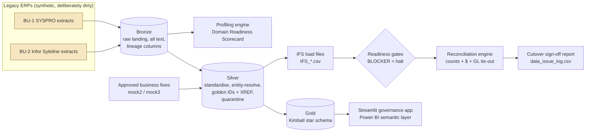

# Architecture

## Layer contracts

| Layer | What it guarantees | Where |
|---|---|---|
| Bronze | Byte-faithful landing of every legacy row (all columns as text) + `_row_num`, `_src_file`, `_ingested_at` | `bronze.py`, tables `bronze_<bu>_<entity>` |
| Silver | Standardised, validated, de-duplicated; **every source row ends in exactly one disposition** (LOADED / CONSOLIDATED / QUARANTINED / EXCLUDED) in `silver_row_ledger` | `silver_*.py` |
| IFS load | Schema-validated files; blockers halt the run | `ifs_load.py`, `gates.py` |
| Reconciliation | Independent recomputation from raw bronze + the load files themselves | `reconcile.py` |
| Gold | Star schema with surrogate keys, no legacy schema leakage | `sql/gold_star_schema.sql`, `gold.py` |

## Design principles

1. **Nothing disappears.** A row-level ledger plus reconciliation makes "where did record X go?" answerable for every source row.
2. **Money is integer cents** with one half-up rounding rule (`money.py`); floats never touch values.
3. **Identity is decided on attributes, not text.** SA-516 Gr 70 and Gr 60 plate never merge (`itemspec.py`).
4. **Steward in the loop.** Fuzzy matches are auto-merged only with tax-ID or name+address evidence; the grey zone goes to a review queue.
5. **Frozen enterprise IDs.** `data/id_registry/enterprise_ids.json` keeps IDs stable between mock loads; merged IDs are retired as aliases.
6. **Docs as code.** The STTM, data dictionary and defect catalogue are generated from the code (`make docs`).
7. **Portable SQL.** All SQL runs on DuckDB and SQLite (recursive CTE for BOM cycles, window functions for surrogate keys).
