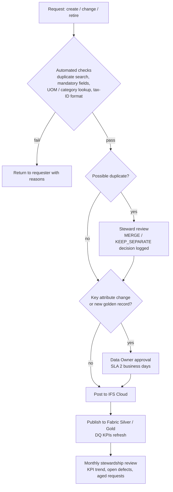

# Create / Change / Retire Workflow

- **Retire** = block for new transactions, keep history; never hard-delete a part, customer or vendor.
- **Cross-BU changes** (shared items/parties) require both BU stewards.
- **Emergency creates** allowed for production-critical parts; steward ratifies within 1 business day.
