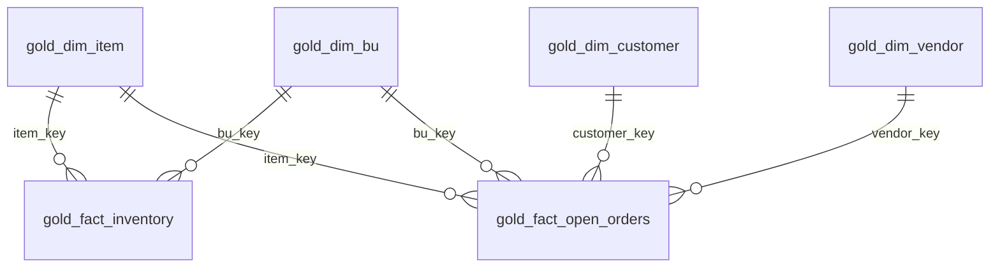

# Power BI Semantic Model (specification)

The Gold star schema is the contract for Power BI (Import or DirectQuery; in Fabric use a Lakehouse SQL endpoint or Direct Lake).
No Power BI Desktop file is shipped (it is Windows-only); this is the model to build.



Relationships: single-direction, one-to-many from each dimension to the facts. `customer_key` / `vendor_key` are null on the opposite order type.

## Measures (DAX)
```DAX
Inventory Value = SUM ( gold_fact_inventory[ext_value_usd] )
Inventory Qty = SUM ( gold_fact_inventory[qty_on_hand] )
Open PO Value = CALCULATE ( SUM ( gold_fact_open_orders[ext_value_usd] ), gold_fact_open_orders[order_type] = "PO" )
Open SO Value = CALCULATE ( SUM ( gold_fact_open_orders[ext_value_usd] ), gold_fact_open_orders[order_type] = "SO" )
Cross-BU Item Share = DIVIDE ( CALCULATE ( COUNTROWS ( gold_dim_item ), gold_dim_item[is_cross_bu_item] = 1 ), COUNTROWS ( gold_dim_item ) )
DQ Score = AVERAGE ( gold_dq_kpi[score_pct] )
Migration Yield = CALCULATE ( AVERAGE ( gold_dq_kpi[score_pct] ), gold_dq_kpi[stage] = "IFS_LOAD" )
```

## Continuity checks (before vs after cutover)
- Inventory Value by category per BU must equal `reconciliation_dollars.csv` loaded values.
- Report on `enterprise_part_no`; legacy codes remain searchable through `legacy_sources` so historical reports keep working.
